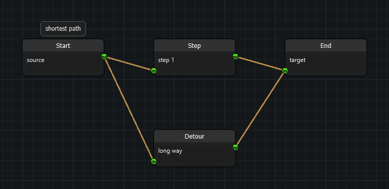

# Graph algorithms (`nodeeditor.node_graph`)

A `Scene` holds a graph. An `Edge` runs from the `Node` owning its **start
(output)** `Socket` to the `Node` owning its **end (input)** `Socket`, so the
graph is directed and data flows from producer to consumer.

`nodeeditor/node_graph.py` implements the algorithms over that graph
**natively**. No third-party graph library is required, and nothing has to be
installed or configured.

```python
from nodeeditor.node_scene import Scene

scene = Scene()
...
scene.topological_order()          # [Node, ...] in dependency order
scene.descendants(node)            # [Node, ...] reachable downstream
scene.ancestors(node)              # [Node, ...] feeding this node
scene.components()                 # [[Node, ...], ...] the disconnected flocks
scene.cycles()                     # [[Edge, ...], ...] the loops in the graph
scene.paths(a, b)                  # [[(Node, Edge), ...], ...] every route
scene.shortest_path(a, b)          # [(Node, Edge), ...] or None
```

The same functions are available as module-level functions taking the scene
as their first argument, for example
`nodeeditor.node_graph.descendants(scene, node)`.



## What counts as an edge

Only an `Edge` whose start socket is an **output** and whose end socket is an
**input** takes part. An `Edge` that is detached, or that was wired
output-to-output, is ignored. Two `Edges` between the same pair of `Nodes`
are two separate edges and both count.

`Group`s (`nodeeditor/node_group.py`) are visual containers. Their edges are
not cut, so a `Group` never changes the shape of the graph. Edges internal to
a collapsed `Group` are hidden on screen but still carry data, so they still
count here.

## Ordering

`topological_order()` puts every `Node` after the `Nodes` feeding it, so a
`Node` can be evaluated once every input it needs has been evaluated. `Nodes`
that do not depend on each other keep their **scene order**, which makes the
result reproducible: the same graph always yields the same sequence.

```python
order = scene.topological_order()
for node in order:
    node.eval()
```

When the graph contains a cycle there is no such order, and
`topological_order()` raises `GraphCycleError`:

```python
from nodeeditor.node_graph import GraphCycleError

try:
    order = scene.topological_order()
except GraphCycleError as error:
    for cycle in error.cycles:
        print([edge.start_socket.node.title for edge in cycle])
```

`scene.cycles()` returns the same cycles without raising, one representative
cycle per cyclic region.

## Components

`components()` returns the disconnected subgraphs of the scene: two `Nodes`
belong to the same component when a chain of `Edges` connects them, whatever
the direction. A `Node` without any connection forms a component of its own.

This is how you find the independent "flocks" of nodes in one scene:

```python
for flock in scene.components():
    print([node.title for node in flock])
```

The components come in scene order, and the `Nodes` inside a component come
in scene order too.

## Paths

A path is a list of `(node, edge)` steps. The `edge` of a step is the `Edge`
that led into its `Node`; the first step carries `None`, because nothing leads
into the first node.

```python
for path in scene.paths(source, target):
    for node, edge in path:
        print(node.title, "via", edge)
```

`paths()` returns every simple path, so two `Edges` between the same pair of
`Nodes` produce two different paths. `shortest_path()` returns the one with
the fewest edges, or `None` when the target cannot be reached.

## Cycle safety

Every traversal is iterative and keeps a visited set. Two consequences:

- A graph containing a cycle **terminates**. Nothing in this module can
  exhaust the interpreter's recursion limit.
- A `Node` reachable through several distinct paths is visited **once**, not
  once per path. A graph of 42 nodes arranged as 20 layers of diamonds takes
  microseconds instead of the several seconds a per-path walk would need.

`Node.markDescendantsDirty()` and `Node.markDescendantsInvalid()` are built
on this and inherit both properties.

## Seeing the result in the calculator example

`examples/example_calculator` has a **Graph Inspector** dock at the bottom of
the window. Its four buttons, and the matching entries in the **Graph** menu,
run the algorithms on the graph of the active tab:

| Button | Calls | Shortcut |
| --- | --- | --- |
| Topological Order | `scene.topological_order()` | Ctrl+Shift+T |
| Flocks | `scene.components()` | |
| Cycles | `scene.cycles()` | |
| Selected Path | `scene.shortest_path()` between the two selected nodes | Ctrl+Shift+P |

Every result is listed with a step number per row. Click a row to select that
node on the canvas and centre the view on it, so the listed order can be
followed in the graph itself.

Asking for the topological order of a graph with a cycle lists the cycles
instead of failing.

