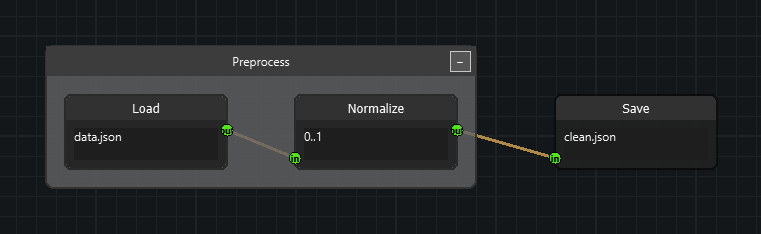
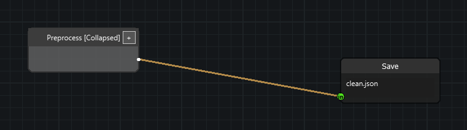

# Group nodes

Groups let you treat several nodes as one box on the canvas. The box can be
moved as a unit, collapsed down to its title bar, and dissolved again — all
without touching the nodes or the edges inside it.

A `Group` is a **visual container**, not a `Node`: it has no sockets, it takes
no part in evaluation, and the nodes inside it keep their positions and edges
at all times. Collapsing only hides things.



```python
from nodeeditor.node_group import Group
```

## 1. Put nodes into a group

Create a group, add nodes to it, and fit the box around them:

```python
import sys
from qtpy.QtWidgets import QApplication

from nodeeditor.node_editor_widget import NodeEditorWidget
from nodeeditor.node_node import Node
from nodeeditor.node_edge import Edge
from nodeeditor.node_group import Group

app = QApplication(sys.argv)

editor = NodeEditorWidget()
scene = editor.scene

a = Node(scene, "A", inputs=[], outputs=[1])
a.setPos(-200, 0)
b = Node(scene, "B", inputs=[1], outputs=[1])
b.setPos(0, 0)
c = Node(scene, "C", inputs=[1], outputs=[])
c.setPos(250, 0)
Edge(scene, a.outputs[0], b.inputs[0])
Edge(scene, b.outputs[0], c.inputs[0])

group = Group(scene, title="My Group")
group.addNode(a)
group.addNode(b)
group.updateBounds()
scene.history.storeHistory("Created group", setModified=True)

editor.show()
sys.exit(app.exec())
```

`updateBounds()` recalculates the box so it fits the children; call it after
adding nodes. `addNode()` also detaches the node from any group it was in
before — a node belongs to at most one group.

## 2. Group whatever the user selected

Grouping from a selection is what an application usually wants:

```python
def group_selected_nodes(self):
    nodes = [item.node for item in self.scene.getSelectedItems() if hasattr(item, "node")]
    if len(nodes) < 2:
        return

    group = Group(self.scene, title=f"Group ({len(nodes)} nodes)")
    for node in nodes:
        group.addNode(node)
    group.updateBounds()
    self.scene.history.storeHistory("Created group", setModified=True)
```

The `hasattr(item, "node")` filter matters: the selection can also contain
`Group` items, and only nodes can become group members.

## 3. Add a menu action and a shortcut

```python
from qtpy.QtGui import QAction, QKeySequence

self.group_action = QAction("Group Selected Nodes", self)
self.group_action.setShortcut(QKeySequence("G"))
self.group_action.triggered.connect(self.group_selected_nodes)
self.menu.addAction(self.group_action)
```

If you build on `NodeEditorWindow`, the `G`, `U` and `C` shortcuts and their
Edit-menu entries already exist — see
[Node grouping](node-grouping.md) for the full list of built-in handlers.

## 4. Collapse and expand

```python
group.collapse()        # hide the children, shrink to the title bar
group.expand()          # show them again, exactly where they were
group.toggleCollapse()  # whichever is the opposite of the current state
group.setCollapsed(True)
group.isCollapsed()     # -> bool
```



While a group is collapsed:

- the nodes inside it and the edges between them are hidden;
- the edges crossing the group boundary are rerouted to small **stub rows** on
  the left and right edges of the box, so the graph stays connected;
- the children keep their positions, which is why expanding restores the
  graph exactly as it was.

## 5. Ungroup or delete

There are three different operations, and picking the wrong one loses work:

| Call | Effect |
| --- | --- |
| `group.ungroup()` | Removes the box, **keeps** the nodes and their edges. |
| `group.deleteWithChildren()` | Removes the box **and** every node inside it. |
| `group.removeNode(node)` | Takes one node out of the group and keeps it. |

## 6. What happens for free

- **Undo and redo** — creating, moving, collapsing, renaming, recolouring,
  ungrouping and deleting a group all stamp history entries, so undo restores
  membership, bounds and the collapsed state.
- **Saving and loading** — groups are part of the scene's JSON. Old files
  written before groups existed still load.
- **Drag and drop** — dragging a node over a group highlights it and drops the
  node in on release.

## Things to keep in mind

- A node belongs to **at most one** group, and groups **cannot nest**.
- Dragging a node out of a group does not remove it — the box grows or shrinks
  to follow. Removal is always explicit.
- Clicking the title bar selects the group alone; the body of an expanded
  group is click-through, so it behaves like plain canvas.
- Only the title bar is interactive: select, drag, collapse and the context
  menu live there.

## Next steps

- [Node grouping](node-grouping.md) — the complete reference: edge stubs,
  selection model, serialization format, context menus, troubleshooting.
- [Groups API](../api/group.md) — every method of `Group`.
