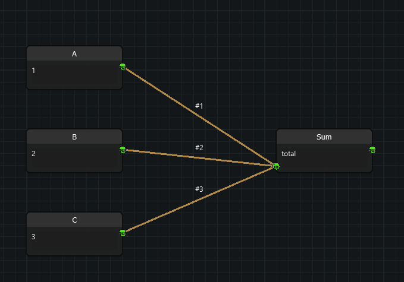

# Ordered multi-input nodes (`MultiInputNode`)

A regular `Node` input socket accepts **one** edge (`input_multi_edged =
False`). A `MultiInputNode` (`nodeeditor/node_multi_input_node.py`) is a
`Node` whose input socket accepts **any number** of edges and reads them
**in an explicit order**:

- by default, the order the edges were **connected** in;
- changeable at any time **from code** (`Edge(..., input_index=n)` at
  connection time, or `setEdgeOrder` / `moveEdgeTo` / `swapEdges` / ...
  afterwards) and from the calculator example's right-click menu;
- visible on the canvas as `#1`, `#2`, `#3`, ... edge labels;
- persisted in the graph file, so it survives save/load, copy/paste and
  undo/redo.



```python
from nodeeditor.node_multi_input_node import MultiInputNode

class Sum(MultiInputNode):
    def __init__(self, scene):
        # one input socket accepting many edges, one output
        super().__init__(scene, "Sum", inputs=[2], outputs=[1])

    def evalImplementation(self):
        return [sum(v for v in self.getOrderedValues() if v is not None)]
```

## Concepts

### `Edge.input_index` — the per-edge order number

Every `Edge` carries `input_index`: its 0-based read position on its **end**
(input) socket (`nodeeditor/node_edge.py`). `0` is read first. `-1` means
"not attached to an input" and is also the append-at-end default, i.e.
read last.

```python
edge = Edge(scene, out_socket, node.inputs[0])                # appended -> read last
edge = Edge(scene, out_socket, node.inputs[0], input_index=0) # inserted -> read first
```

The value is owned and compacted by the input socket (below); assign it
directly only together with `compactEdgeOrder()`. Output sockets are never
ordered — attaching an edge as an output end resets it to `-1`.

### Socket ownership and compaction

An input `Socket` keeps its edges in read order and rewrites `0..n-1` onto
them after every add/remove (`nodeeditor/node_socket.py`: `addEdge`,
`removeEdge`, `_reindexEdges`, `orderedEdges`). Consequences:

- connecting appends (connection order preserved automatically);
- removing closes the gap (no holes, positions always valid);
- `Socket.orderedEdges()` is the read order; raw `Socket.edges` is kept in
  the same order by the compaction above.

### Connection order vs manual order

There is only one order, with two ways to set it: new edges default to the
end (connection order), and any reorder call rewrites it from then on. No
mode switch is needed.

## Reading the inputs

All methods take an optional socket `index` defaulting to
`multi_input_socket` (see below).

| Method | Returns |
|---|---|
| `getOrderedEdges()` | `[Edge, ...]` in read order |
| `getOrderedSources()` | `[(node, socket), ...]`, one entry **per edge** — a source connected twice appears twice |
| `getOrderedValues()` | `[evaluated, ...]`, one entry per edge; a source that fails to evaluate contributes `None` instead of raising |
| `getOrderedNodes()` | `[Node, ...]` in read order |
| `describeInputOrder()` | `"0: Input [out 0]\n1: Add [out 0]"` — handy for tooltips and logging |

## Changing the order

All reorder methods return `True` when the order actually changed, and on
success mark the node and its descendants dirty so they re-evaluate.

```python
node.setEdgeOrder([edge_b, edge_a])   # partial lists keep the rest in place
node.setEdgeOrderByNodes([node_b, node_a])
node.moveEdgeTo(edge, 0)              # absolute position
node.moveEdgeBy(edge, -1)             # relative shift, clamped at both ends
node.swapEdges(edge_a, edge_b)
node.reverseEdgeOrder()
node.compactEdgeOrder()               # only needed after raw input_index assignment

# raw assignment also works, but must be followed by compaction
edge.input_index = 5
node.compactEdgeOrder()

# introspection
node.getMultiSocket()                 # the ordered input Socket (or None)
socket.edgeIndex(edge)                # read position, or -1 if not connected
```

## Subclassing

`MultiInputNode` deliberately defines no `__init__`, so it mixes into an
existing node hierarchy without touching its constructor chain:

```python
class CalcNode_Sum(MultiInputNode, CalcNode): ...
```

Two class attributes control the shape:

| Attribute | Default | Meaning |
|---|---|---|
| `multi_input_all_inputs` | `True` | every input socket accepts many edges |
| `multi_input_socket` | `0` | with `multi_input_all_inputs = False`, the single input socket that accepts many edges (other inputs stay single-edge) |

```python
class Merge(MultiInputNode):
    multi_input_all_inputs = False
    multi_input_socket = 1      # only inputs[1] is ordered/multi
```

Implementation notes:

- `initSettings` turns `input_multi_edged` on (all inputs, or the one
  socket trimmed in `initSockets` when not all).
- `onEdgeConnectionChanged` compacts the order and refreshes the `#N`
  labels after **every** connection path (drag, reroute, remove, paste),
  because they all call this hook. `onInputChanged` is intentionally **not**
  overridden, so subclass chains such as `CalcNode.onInputChanged`
  (dirty-mark + eval) keep working untouched.

## Order labels (`#1`, `#2`, ...)

When `show_input_order_labels` is `True` (the default), every edge on the
ordered input is labeled `#1`, `#2`, ... — the 1-based display of its read
position. Labels are written on every connection change and every reorder,
compacted on removal, and cleared when an edge detaches (only when the
label still matches the `#N` pattern, so a custom label you set from code
survives disconnects). Customize per class:

```python
class Quiet(MultiInputNode):
    show_input_order_labels = False
```

```python
node.orderLabel(0)              # "#1" (staticmethod, override for custom text)
node.updateInputOrderLabels()   # backfill after re-enabling the flag
```

One caveat, shared with eval/dirty-marking in this codebase: labels are
applied in `onEdgeConnectionChanged`, which the view (`EdgeDragging`,
`EdgeRerouting`, `Edge.remove`) calls for you. If you connect nodes purely
from code with `Edge(scene, out, node.inputs[0])`, send the same
notifications a drag would, then read the labels:

```python
edge = Edge(scene, out_socket, node.inputs[0])
node.onEdgeConnectionChanged(edge)   # like EdgeDragging does
assert edge.getLabel() == "#1"
```

## Worked example: `Sum`

`examples/example_calculator/nodes/multi_input.py` (`CalcNode_Sum`,
registered as `OP_NODE_SUM` in `examples/example_calculator/calc_conf.py`)
sums every connected input in read order and shows the order in its
tooltip. Right-click menus in
`examples/example_calculator/calc_sub_window.py` expose reordering without
code:

- node menu (on a `MultiInputNode` with 2+ edges): *Reverse Input Order*,
  *Move First Input to Last*, *Move Last Input to First*;
- edge menu (on an edge feeding such a socket): *Move Input Earlier
  (read sooner)*, *Move Input Later (read later)*.

All menu actions store an undo-history entry.

## Persistence and compatibility

- `Edge.serialize()` stores `'input_index'`; `Edge.deserialize()` restores
  it with `data.get('input_index', -1)` **before** attaching the sockets,
  so each edge inserts at its stored slot. Old files without the key load
  in file (connection) order — the same back-compat pattern as the
  `'label'` key (see `docs/EDGE_LABELS.md`).
- Because the number travels on the edge, the order survives save/load,
  copy/paste, and undo/redo even when the file's `"edges"` array is
  shuffled.
- Clipboard paste and history snapshots go through the same
  `Edge`/`Socket` APIs, so no extra handling was needed.
- Rerouting onto a multi-edge input keeps the socket's other edges
  (`nodeeditor/node_edge_rerouting.py`); rerouting onto a single-edge
  input still replaces, as before. A rerouted edge is treated as a new
  connection on the target socket (appended).

## Socket-level API (without `MultiInputNode`)

The ordering machinery lives on `Socket` and works for any multi-edge
input, no subclass required:

```python
socket.orderedEdges()          # read order
socket.edgeIndex(edge)         # position or -1
socket.compactEdgeOrder()      # re-sort + renumber, returns changed?
socket.setEdgeOrder([...])     # partial lists allowed, foreign/dupes skipped
socket.moveEdgeTo(edge, pos)
socket.swapEdges(a, b)
```

## Testing

`tests/test_100_multi_input.py` (27 tests, offscreen `QApplication`)
covers connection order, explicit numbering, gap compaction on removal,
all reorder operations, label sync/clearing/opt-out, `input_index`
serialization, order restoration from shuffled file order, old-file loading,
and a full scene save/load round-trip:

```powershell
.\.venv\Scripts\python.exe -m unittest discover -s tests -v
```

The `connect()` test helper mirrors `EdgeDragging.edgeDragEnd` by calling
`node.onEdgeConnectionChanged(edge)` after `Edge(...)` — see the caveat in
*Order labels* above.
