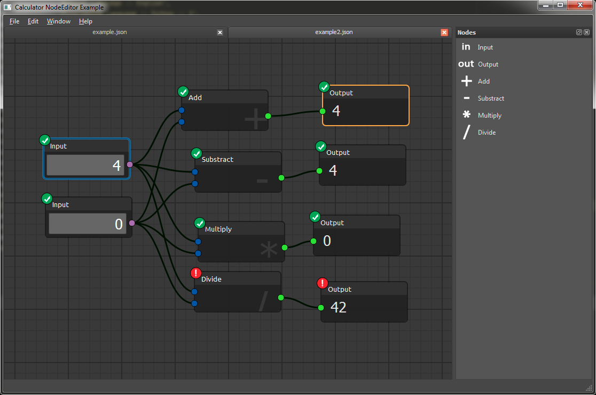

# Node Editor

A node editor framework for Qt. Build interactive graph interfaces out of
draggable nodes, connectable sockets and edges — with undo/redo, JSON
serialization and room for your own evaluation logic.

The framework talks to Qt through [QtPy](https://github.com/spyder-ide/qtpy),
so the same code runs on PyQt5, PySide2, PyQt6 and PySide6.



## Install

```bash
pip install nodeeditor-qtpy[pyqt6]
```

The distribution is `nodeeditor-qtpy`; the import package is `nodeeditor`.

## A first graph

```python
import sys

from qtpy.QtWidgets import QApplication

from nodeeditor.node_editor_widget import NodeEditorWidget
from nodeeditor.node_node import Node
from nodeeditor.node_edge import Edge

app = QApplication(sys.argv)

editor = NodeEditorWidget()
scene = editor.scene

source = Node(scene, title="Value", outputs=[1], output_text=["out"])
sink = Node(scene, title="Print", inputs=[1], input_text=["in"])
Edge(scene, source.outputs[0], sink.inputs[0])

editor.show()
sys.exit(app.exec())
```


## What you get

- **Nodes, sockets and edges** you fully control: titles, colours, socket
  types, labels, and the shape each socket is drawn with.
- **Undo / redo** for every graph change, and **serialization** to JSON files
  that diff cleanly in version control.
- **Evaluation hooks** for your own logic, with dirty/invalid propagation
  across the graph.
- **Editing niceties**: hovering effects, edge dragging, edge cutting,
  snapping, multi-input nodes, node groups, and node/edge labels.
- **Theming** through a color scheme object, so a whole application can be
  restyled without touching the graph code.

## Where to go next

- [Installation](installation.md) — install options, requirements, and what
  happens when no Qt binding is present.
- [Quick start](quickstart.md) — build your first graph, then customize it.
- [Events](events.md) — subscribe to what happens inside the scene.
- [Group nodes](guides/group-nodes.md) — treat a set of nodes as one box.
- [API reference](api/index.md) — the classes and functions, straight from the
  source.
