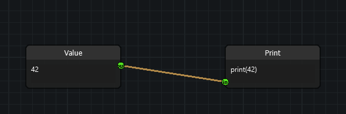
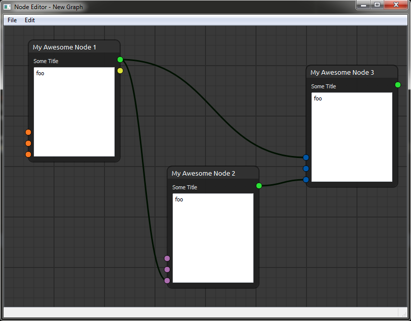

# Quick start

## The editor and the scene

`NodeEditorWidget` is a ready-made widget that owns a `Scene` and a graphics
view. If you would rather drive the graph without a widget — in a test, or
inside a larger application — build a `Scene` directly.

```python
from nodeeditor.node_scene import Scene

scene = Scene()
```

## Creating a node

A `Node` belongs to a scene and declares its sockets up front. The `inputs`
and `outputs` lists hold socket types, and the matching `input_text` and
`output_text` lists hold the labels drawn beside them.

```python
from nodeeditor.node_node import Node

source = Node(scene, title="Value", outputs=[1], output_text=["out"])
sink = Node(scene, title="Print", inputs=[1], input_text=["in"])
```

A node registers itself with the scene when it is created, so there is nothing
to add by hand.

### Socket types

The integer in `inputs` / `outputs` selects the socket type, which decides its
colour:

| Type | Colour | Type | Colour |
| --- | --- | --- | --- |
| `0` | orange | `4` | red |
| `1` | green | `5` | yellow |
| `2` | blue | `6` | grey |
| `3` | purple | | |

The shape a socket is drawn with is a separate concern — see
[Socket shapes](guides/socket-shapes.md).

## Connecting nodes

An `Edge` connects an output socket to an input socket. It registers itself
with the scene as well.

```python
from nodeeditor.node_edge import Edge

Edge(scene, source.outputs[0], sink.inputs[0])
```



The result is a graph you can drag around, edit and undo.

## Showing the graph

```python
import sys

from qtpy.QtWidgets import QApplication
from nodeeditor.node_editor_widget import NodeEditorWidget

app = QApplication(sys.argv)

editor = NodeEditorWidget()
editor.show()

sys.exit(app.exec())
```



## Saving and loading

Scenes serialize to plain JSON, which keeps graph files readable and easy to
diff in version control.

```python
scene.saveToFile("graph.json")
scene.loadFromFile("graph.json")
```

Use `scene.serialize()` and `scene.deserialize(data)` if you want the data as
a dictionary instead of a file.

## Adding your own logic

Subclass `Node` and override `evalImplementation()` to plug your own
computation into the graph. The framework marks nodes dirty and invalid and
propagates that through the edges for you.

```python
from nodeeditor.node_node import Node


class NumberNode(Node):
    def __init__(self, scene, title="Number", inputs=None, outputs=None):
        super().__init__(scene, title=title, inputs=inputs or [1], outputs=outputs or [1])

    def evalImplementation(self):
        self.markDirty(False)
        self.markInvalid(False)
        self.markDescendantsInvalid(False)
        self.markDescendantsDirty()
        return 42
```

The [multi-input nodes](guides/multi-input-nodes.md) and
[graph algorithms](guides/graph-algorithms.md) guides show how this scales to
larger graphs.

## Where to go next

- [Socket shapes](guides/socket-shapes.md) — draw sockets as triangles,
  chevrons or anything you like.
- [Node grouping](guides/node-grouping.md) — collapse a subgraph into one node.
- [Node labels](guides/node-labels.md) and [edge labels](guides/edge-labels.md)
  — annotate a graph without changing its structure.
- [API reference](api/index.md) — every class and method.
